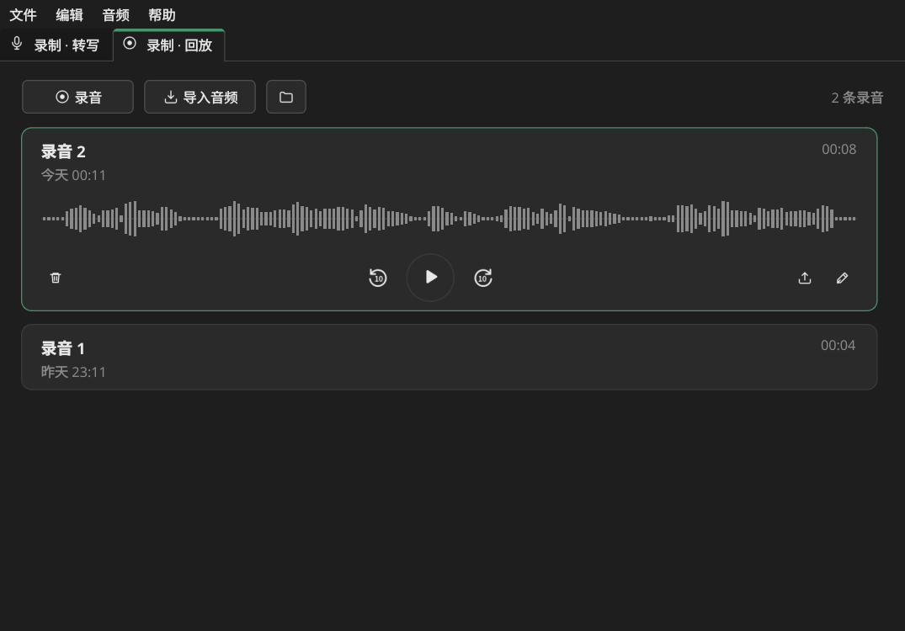
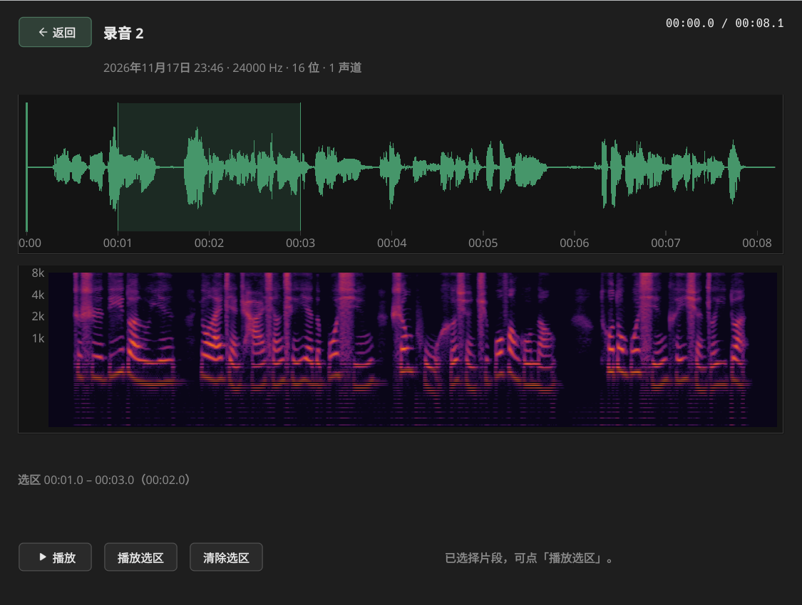
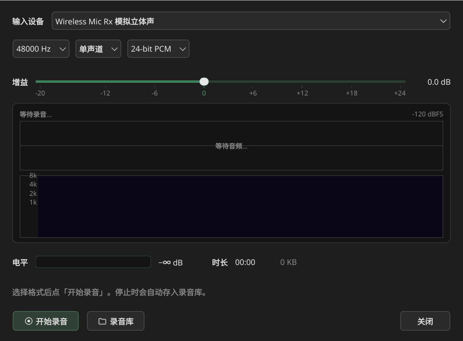
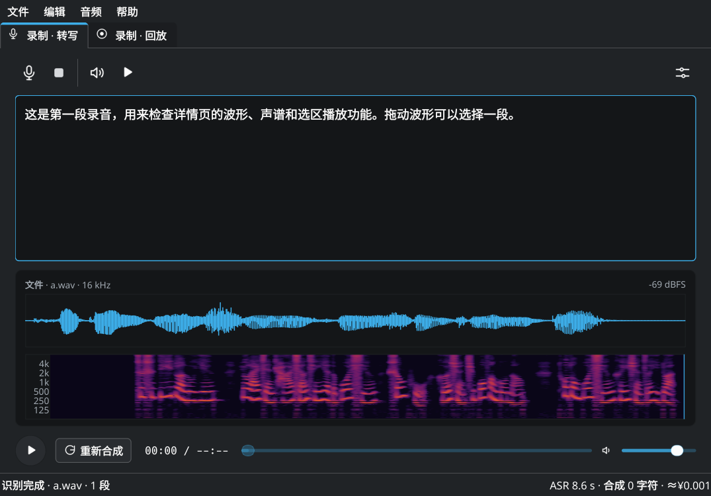
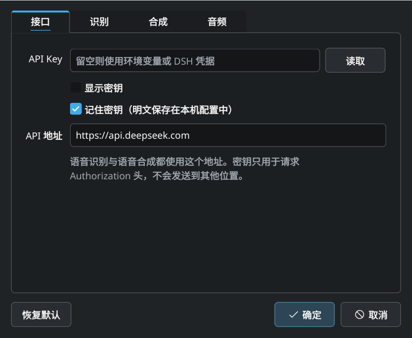
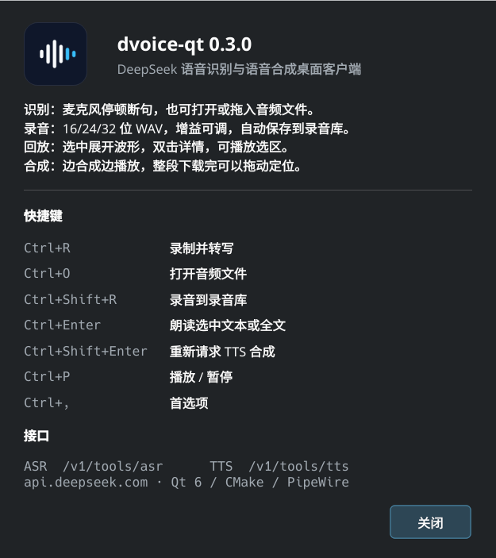

# dvoice-qt

DeepSeek 语音识别（ASR）与语音合成（TTS）的 Qt 6 桌面客户端。整个程序只有两个标签页：

- **录制 · 转写**：麦克风连续听写，或者打开/拖入音频文件识别文字；也保留 TTS 朗读。
- **录制 · 回放**：录音库 + 播放控件，录音自动统一存放，启动后自动列出。


## 功能

- **连续听写**：说完一句停顿约 650 ms 自动切段上传，文本按顺序追加；手动停止会冲刷最后一段。
- **自动入库**：听写和独立录音都会保存到同一个录音库，附标题、时间、时长、波形峰值和转写文本。
- **录音格式与增益**：录音对话框可选采样率（16/24/44.1/48 kHz）、声道（单/双）、位深（16/24/32 位 PCM WAV），并有 -20～+24 dB 的输入增益滑条（带 -20/-12/-6/0/+6/+12/+18/+24 dB 标尺），实时作用到采集、电平、波形和最终 WAV。
- **实时电平**：录音时显示电平条、dBFS、时长和文件大小，同时显示波形与声谱图。
- **紧凑录音库**：只有选中项展开波形和操作按钮，其他录音保持紧凑；点击选中，双击进入详情。
- **录音详情**：高分辨率全段波形、整段声谱图，拖动选区后可只播放选中的片段。
- **文件识别**：文件 → 打开音频（Ctrl+O）或直接把音频拖进窗口，解码后按停顿分段识别。
- **重新合成**：播放条上明确的「重新合成」按钮，丢弃当前音频并按当前选区/全文重新请求 TTS。
- **声谱图**：播放/解码时显示“时间 × 频率”的滚动热力图；录音时显示瞬时柱状频谱。
- **设备选择**：输入/输出设备可在首选项选择；菜单里有独立的麦克风/扬声器测试对话框。
- **跟随系统主题**：普通按钮、输入框、标签页使用 Qt 默认外观；播放控件和波形单独设计。

| 录音库 | 录音详情 |
|---|---|
|  |  |

| 录音对话框 | 文件识别 |
|---|---|
|  |  |





## 构建

依赖 Qt 6.5+（建议 6.8+）、CMake 3.21+、C++20 编译器。至少需要 Qt 的 Core / Gui / Widgets / Network / Multimedia / Svg 模块；音频文件解码和回放使用 Qt Multimedia 的 FFmpeg 后端。

```bash
cmake -S . -B build -DCMAKE_BUILD_TYPE=Release
cmake --build build -j"$(nproc)"
./build/dvoice-qt
```

安装（包含图标和 desktop 文件）：

```bash
sudo cmake --install build
```

## 录音库

所有录音统一保存在：

```text
QStandardPaths::GenericDataLocation/dvoice-qt/recordings
```

Linux 上通常是 `~/.local/share/dvoice-qt/recordings`。目录里是原始音频文件（录音为 WAV）加同名 `.json` 元数据；启动或切换回回放页时自动扫描，外部放进来的 WAV/MP3/FLAC 等也会出现在列表里（没有元数据时标题用文件名）。

- **听写录音**：停止听写时自动保存，转写完成后把文本写回元数据。
- **独立录音**：录音对话框停止时自动保存，不需要先选路径。
- **导出**：卡片右侧的导出按钮可复制到任意位置。
- **打开文件夹**：录音页顶部文件夹按钮，或「文件 → 打开录音库文件夹」。

录音结果先在内存中采集（上限 512 MiB，48 kHz 单声道 32-bit 约 44 分钟），达到上限会自动停止并保存。

## 使用

### 录制 · 转写

点击工具栏麦克风或按 `Ctrl+R`。状态栏显示「聆听中…」，检测到语音后变成「检测到语音…停顿后自动断句」。停止后音频自动入库，识别结果继续追加到文本框，并在识别队列空闲后写回录音元数据。

DeepSeek ASR **不支持流式识别**，一次请求只能发完整音频（≤120 秒、≤8 MiB）。这里的实时感是分句级增量：VAD 在停顿处切段，每段单独上传。实测 6 秒音频约 1.4 秒出结果。

打开音频文件：

- 菜单「文件 → 打开音频…」（`Ctrl+O`），或把文件拖进窗口；
- 支持格式取决于 Qt Multimedia 后端，实测 WAV / MP3；
- 解码成 16 kHz 单声道后按停顿切段，逐段识别并把文本追加到文本框；
- 长文件只在监视区显示前 10 秒的波形/声谱，识别仍处理完整文件。

TTS 朗读仍在转写页：选中文本后 `Ctrl+Enter` 只读选中内容；没有选区则读全文。`Ctrl+P` 播放/暂停，整段下载完可拖动定位。播放条上的「重新合成」（`Ctrl+Shift+Enter`）会丢弃当前已合成音频，按当前文本重新请求 TTS。

### 录制 · 回放

点「录音」打开录音对话框：

- 选择输入设备、采样率、声道、位深；
- 「增益」滑条 -20～+24 dB（0 dB 为原始电平），下方标尺标出常用 dB 值；录音中可实时调整，作用到电平、波形和最终 WAV；
- 开始录音后显示电平、时长、大小、波形和声谱图；
- 停止即保存到录音库；关闭对话框后列表自动刷新。

卡片操作：

- 单击卡片选中，只有选中项展开波形和操作按钮，其他录音保持紧凑；
- 播放/暂停；前进/后退 10 秒；点击波形跳到对应位置；
- 铅笔重命名；垃圾桶删除；导出按钮复制音频；
- 双击卡片进入详情：高分辨率全段波形 + 整段声谱图；在波形上拖动选择一段后点「播放选区」，单击波形定位；
- 顶部的「导入音频」把文件复制进录音库用于回放（转写请用转写页的「打开音频」）。

### 快捷键

| 快捷键 | 动作 |
|---|---|
| `Ctrl+R` | 录制并转写 |
| `Ctrl+O` | 打开音频文件识别 |
| `Ctrl+Shift+R` | 录音到录音库 |
| `Ctrl+Enter` | 朗读选中文本或全文 |
| `Ctrl+Shift+Enter` | 重新请求 TTS 合成 |
| `Ctrl+P` | 播放 / 暂停 |
| `Ctrl+.` | 停止录音和播放 |
| `Ctrl+,` | 首选项 |
| `Ctrl+S` | 导出文本 |
| `Ctrl+L` | 清空文本 |

## 音频与识别链路

- **听写**：`QAudioSource` 固定 16 kHz / 单声道 / 16-bit；VAD 以 20 ms 帧计算 RMS，停顿超过阈值就切段，上传前包成 WAV。
- **录音**：按用户在录音对话框里选的格式采集，原始 PCM 留在内存；导出时按位深打包成 16/24/32 位 WAV。
- **识别上传**：录音和导入文件都会先转成 16 kHz 单声道 16-bit；导入使用线性重采样，声道取平均。
- **TTS 播放**：请求 `format=pcm`，得到 24 kHz / 单声道 / 16-bit 裸 PCM，直接写入 `QAudioSink`。
- **频谱**：录音用 64 bin 的瞬时频谱；播放/文件用 480×160 的滚动声谱图（对数频率 60 Hz–8 kHz，magma 色标）。

## 代码结构

```text
src/core/
  asr.*             ASR 客户端 + 顺序识别队列、重试
  tts.*             TTS 流式 PCM 客户端 + 文本切块
  recorder.*        16 kHz 听写采集与 VAD
  audiorecorder.*   可配置格式的录音采集
  recordingstore.*  录音库目录、元数据、列表
  audiofile.*       音频文件解码（QAudioDecoder → 16k mono）
  pcm.*             PCM 转换与重采样
  player.*          TTS 播放器（流式 + 拖动定位）
  settings.*        QSettings、key 发现
  wav.*             PCM → WAV（16/24/32 位）
  audiodevices.*    设备枚举
src/
  audiomonitor.*    波形 / 频谱 / 声谱图
  librarypage.*     录音库列表与回放
  recordingcard.*   录音卡片（选中展开）
  recordingdetail.* 录音详情（波形、声谱、选区播放）
  recorddialog.*    录音对话框（格式、电平、保存）
  preferences.*     首选项 / 关于
  devicetest.*      麦克风 / 扬声器测试
  mainwindow.*      两个标签页与全局操作
```

## 计费

界面右下角按 ASR 0.39 元/小时、TTS 1.5 元/万计费字符估算，只用于参考，以账单为准。TTS 汉字按 2 个计费字符、其他按 1 个；单次请求控制在 8000 计费字符以内。

## 隐私

音频上传到 `api.deepseek.com/v1/tools/asr` 识别，朗读文本发到 `/v1/tools/tts` 合成；API Key 只放在 `Authorization` 头。录音库在本机，不上传。密钥勾选「记住」时明文保存在本机 QSettings，不勾选则只在当前进程内使用。

## 限制

- ASR 没有流式接口，也没有词级时间戳；实时只能到句级。
- 导入文件的识别发生在转写页；回放页的「导入音频」只入库，不自动转写。
- 录音库是单层目录，没有搜索、标签或文件夹；外部文件没有元数据时只能按文件名和文件时间显示。
- 波形不可缩放；卡片波形是 180 点峰值。
- TTS 不支持语速调节，也没有词级时间戳。
- 超长文本会切成多个 TTS 请求，块与块之间可能有短停顿。

## 调试选项

```bash
# 界面
./build/dvoice-qt --demo --screenshot out/main.png
./build/dvoice-qt --dark --demo --screenshot out/main-dark.png
./build/dvoice-qt --light --demo --screenshot out/main-light.png
./build/dvoice-qt --tab 1 --screenshot out/library.png
./build/dvoice-qt --detail --screenshot out/detail.png
./build/dvoice-qt --record-dialog --screenshot out/record.png
./build/dvoice-qt --prefs --screenshot out/prefs.png
./build/dvoice-qt --about --screenshot out/about.png

# 真实接口
./build/dvoice-qt --probe-tts "你好，这是测试。" --out out/test.wav
./build/dvoice-qt --probe-asr out/test.wav
./build/dvoice-qt --probe-play "播放链路测试"
./build/dvoice-qt --probe-seek "播放完成后定位"
./build/dvoice-qt --probe-vad
./build/dvoice-qt --probe-record 3 --out out/record.wav
./build/dvoice-qt --probe-audiofile out/test.wav
```

`--open <file>`、`--dictation <seconds>`、`--record-dialog-auto <seconds>`、`--play-library` 和 `--screenshot-delay <ms>` 用于自动化检查。

播放链路排查可加 `DV_DEBUG_AUDIO=1`，会输出 sink 状态、预缓冲、写缓冲、欠载和帧对齐日志。
