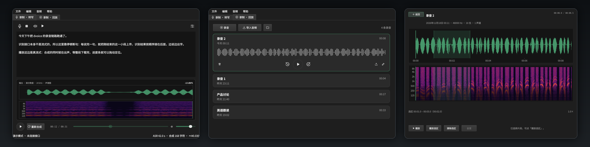

# dvoice-qt

`dvoice-qt` 是 DeepSeek 语音识别（ASR）与语音合成（TTS）的 Qt 6 桌面客户端。程序只有两个标签页：
**录制 · 转写** 用麦克风连续听写，或打开、拖入音频文件识别文字，同时保留 TTS 朗读；
**录制 · 回放** 管理录音库，试听、导出并查看共用时间轴的波形与声谱图。

DeepSeek ASR 不支持流式识别，客户端用 VAD 在停顿处切句，每句单独上传，结果按顺序追加，
做到句级实时；TTS 则边下载边播放。



## 快速开始

**依赖**

- Qt 6.5+：Widgets、Network、Gui、Multimedia、Svg
- CMake ≥ 3.21，支持 C++20 的编译器
- 音频解码与回放使用 Qt Multimedia 的 FFmpeg 后端

Arch Linux：

```bash
sudo pacman -S --needed base-devel cmake qt6-base qt6-multimedia \
  qt6-multimedia-ffmpeg qt6-svg
```

Debian / Ubuntu：

```bash
sudo apt install qt6-base-dev qt6-multimedia-dev libqt6svg6-dev cmake g++
```

**构建**

```bash
cmake -S . -B build -DCMAKE_BUILD_TYPE=Release
cmake --build build -j"$(nproc)"
```

生成 `build/dvoice-qt`。

**配置 API Key**

在 GUI 中打开「编辑 → 首选项…」（`Ctrl+,`）填写，也可以设置环境变量：

```bash
export DEEPSEEK_API_KEY=sk-...
```

未配置时还会只读回退到 `~/.dsh/.credentials.yaml`。

**运行**

```bash
./build/dvoice-qt
```

把音频文件拖进窗口即可转写。录音默认保存在 `~/.local/share/dvoice-qt/recordings`，目录里是
WAV 和同名 JSON 元数据；外部音频可以用「导入音频」放进录音库。

**安装**

```bash
sudo cmake --install build
```

默认安装到 `/usr/local/bin`，同时安装应用图标和 desktop 文件。

## 代码结构

```text
src/
├── core/                  # 与界面无关，GUI 链接为 dvoice-core 静态库
│   ├── asr.*              # ASR 客户端、顺序识别队列
│   ├── tts.*              # TTS 流式 PCM 客户端与文本切块
│   ├── recorder.*         # 16 kHz 听写采集与 VAD 切句
│   ├── audiorecorder.*    # 可配置格式的录音采集与增益
│   ├── recordingstore.*   # 录音库目录、元数据、峰值
│   ├── audiofile.*        # 音频文件解码（QAudioDecoder）
│   ├── pcm.*              # PCM 混音、重采样、峰值
│   ├── player.*           # TTS 流式播放与拖动定位
│   ├── wav.*              # PCM → 16/24/32 位 WAV
│   ├── settings.*         # QSettings 与 Key 发现
│   └── audiodevices.*     # 设备枚举
├── audiomonitor.*         # 波形 / 频谱 / 声谱图
├── librarypage.*          # 录音库列表与回放
├── recordingcard.*        # 录音卡片（选中展开）
├── recordingdetail.*      # 详情波形、声谱、选区与滚轮缩放
├── recorddialog.*         # 录音对话框（格式、增益、电平）
├── preferences.*          # 首选项 / 关于
├── devicetest.*           # 麦克风 / 扬声器测试
├── theme.*                # 跟随 QPalette 的主题
├── mainwindow.*           # 两个标签页与全局操作
└── main.cpp
assets/                    # SVG 图标与 desktop 文件
CMakeLists.txt
```

## 说明

- ASR 没有流式接口和词级时间戳，实时性只到句级；单段上限 120 秒、8 MiB，超长音频会自动切段。
- 录音库是单层目录，没有搜索、标签或文件夹。
- 录音详情里波形和声谱共用一条时间轴：滚轮缩放、拖动声谱图平移、双击复位；在波形上拖动选择片段。
- 界面右下角按 ASR 0.39 元/小时、TTS 1.5 元/万计费字符估算，仅供参考。音频只上传用于识别与合成，录音库始终保存在本机。
