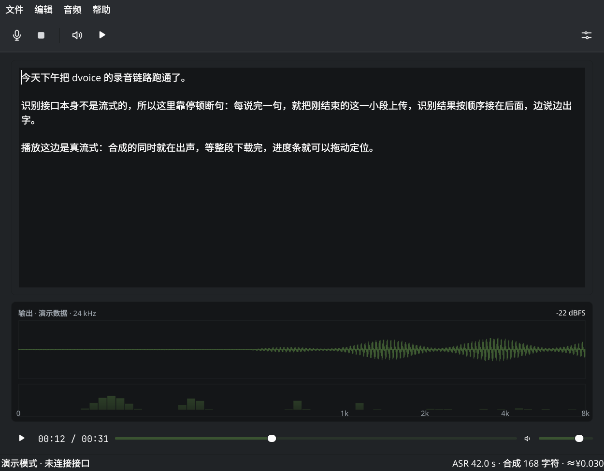
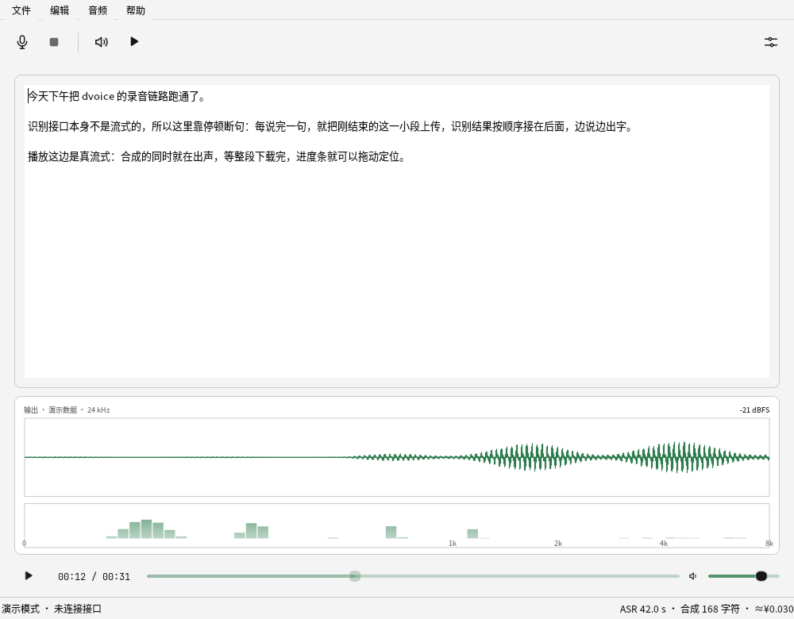
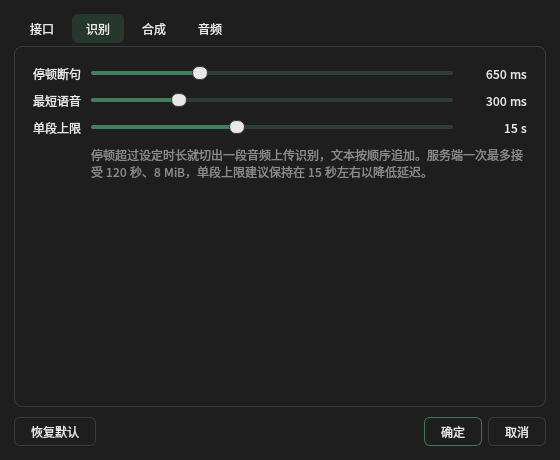

# dvoice-qt

DeepSeek 语音识别（ASR）与语音合成（TTS）的 Qt 6 桌面客户端。主界面只有文本区和播放控件，没有侧栏。



## 功能

- **连续听写**：麦克风持续采集，说完一句停顿约 650 ms 就自动切出一段上传识别，文本按顺序追加到文本框；也可以随时手动停止，停止时会冲刷最后一段。
- **流式朗读**：TTS 返回的 PCM 边下载边播放，不用等整段合成完；整段收完后进度条可以拖动定位。
- **波形与频谱**：录音/播放时实时显示最近 2 秒波形和 60 Hz–8 kHz 对数频谱，并给出 RMS 电平。
- **设备选择**：首选项里可以分别指定输入、输出设备，也可以走系统默认；设备变更在下次录音/播放时生效。
- **麦克风 / 扬声器测试**：菜单里独立的测试对话框，麦克风测试实时显示电平和波形，扬声器测试可以播放三音测试音或朗读一句测试语。
- **首选项与关于**：接口、识别断句、合成音色、音频设备四个标签页；关于页列出快捷键和接口。
- **跟随系统主题**：所有界面颜色从 `QPalette` 派生，深色/浅色下都不写死颜色；应用图标除外。

| 浅色 | 首选项 |
|---|---|
|  |  |

| 识别断句 | 关于 |
|---|---|
|  |  |

## 构建

依赖 Qt 6.5+、CMake 3.21+、C++20 编译器。需要 Qt 的 Core / Gui / Widgets / Network / Multimedia / Svg 模块。

```bash
cmake -S . -B build -DCMAKE_BUILD_TYPE=Release
cmake --build build -j"$(nproc)"
./build/dvoice-qt
```

安装（会同时安装应用图标和 desktop 文件）：

```bash
sudo cmake --install build
```

## API Key

按以下顺序读取，前一个为空才尝试后一个：

1. 首选项 → 接口里保存的 key；
2. 环境变量 `DEEPSEEK_API_KEY`；
3. `~/.dsh/.credentials.yaml` 里的 `DEEPSEEK_API_KEY`。

勾选「记住密钥」时会明文写入本机 `QSettings`；不勾选则只在当前进程内使用。

## 使用

### 听写

点击工具栏麦克风，或按 `Ctrl+R`。状态栏显示「聆听中…」，检测到语音后会变成「检测到语音…停顿后自动断句」。每段识别完成就追加到文本框，文本可以随时手动编辑。

DeepSeek ASR **不支持流式识别**，一次请求只能发完整音频（≤120 秒、≤8 MiB）。所以这里的「边听边出字」是分句级增量：靠 VAD 在停顿处切段，每段单独上传。实测 6 秒音频约 1.5 秒出结果，正常语速下队列跟得上。

首选项 → 识别里可以调：

- **停顿断句**：静音多久算一句结束，默认 650 ms；
- **最短语音**：低于这个长度的声音当噪声丢弃，默认 300 ms；
- **单段上限**：连续说话不停顿时强制切段，默认 15 秒。

### 朗读

选中一段文字后按 `Ctrl+Enter` 只读选中内容；没有选区则朗读全文。`Ctrl+P` 播放/暂停；合成完成后可以拖动进度条定位。长文本会按句切块，每块单独请求。

TTS 只有 `stella`（女声）和 `tide`（男声）两个音色，不支持调节语速，也没有词级时间戳。

### 快捷键

| 快捷键 | 动作 |
|---|---|
| `Ctrl+R` | 开始 / 停止录音 |
| `Ctrl+Enter` | 朗读选中文本或全文 |
| `Ctrl+P` | 播放 / 暂停 |
| `Ctrl+.` | 停止录音和播放 |
| `Ctrl+,` | 首选项 |
| `Ctrl+S` | 导出文本 |
| `Ctrl+L` | 清空文本 |

### 测试设备

- 音频 → 测试麦克风：选择输入设备，实时看电平和波形；对麦克风说话时绿色电平条应明显抬起。
- 音频 → 测试扬声器：选择输出设备，先播三音测试音确认通路，再朗读测试语确认 TTS 和音量。

## 代码结构

```
src/core/
  asr.*           ASR 客户端（手动 multipart）+ 顺序识别队列、重试
  tts.*           TTS 客户端（HTTP 流式 PCM）+ 文本按句切分
  recorder.*      QAudioSource 采集、VAD 分段、电平
  player.*        QAudioSink 边收边播、暂停、完成后拖动定位
  settings.*      QSettings、key 发现
  wav.*           PCM → WAV
  audiodevices.*  设备枚举与按 id 查找
src/
  audiomonitor.*  波形 + FFT 频谱
  preferences.*   首选项、关于
  devicetest.*    麦克风 / 扬声器测试
  mainwindow.*    主窗口与交互
  theme.*         palette 派生样式和图标
```

### 音频格式

- 录音：`QAudioSource` 固定请求 16 kHz / 单声道 / 16-bit，PipeWire 负责从设备格式转换；上传前包成标准 WAV。
- 播放：TTS 请求 `format=pcm`，得到 24 kHz / 单声道 / 16-bit 裸 PCM，直接喂给 `QAudioSink`。
- 文本：TTS 汉字按 2 个计费字符、其他按 1 个，单请求控制在 8000 计费字符以内，避开 10,000 字符和 64 KiB 请求体上限。

### 计费

界面右下角按 ASR 0.39 元/小时、TTS 1.5 元/万计费字符估算，只用于心里有数，以账单为准。ASR 按音频时长精确到秒计费，TTS 按计费字符数计费。

## 调试选项

```bash
# 离线界面检查
./build/dvoice-qt --demo --screenshot out/main.png
./build/dvoice-qt --dark --demo --screenshot out/main-dark.png
./build/dvoice-qt --prefs --screenshot out/prefs.png
./build/dvoice-qt --prefs-tab 1 --screenshot out/prefs-asr.png
./build/dvoice-qt --about --screenshot out/about.png
./build/dvoice-qt --mic-test --screenshot out/mic.png
./build/dvoice-qt --speaker-test --screenshot out/speaker.png

# 真实接口探针
./build/dvoice-qt --probe-tts "你好，这是测试。" --out out/test.wav
./build/dvoice-qt --probe-asr out/test.wav
./build/dvoice-qt --probe-play "这是一段播放链路测试。"
./build/dvoice-qt --probe-seek "播放完成后拖动定位。"
./build/dvoice-qt --probe-vad
```

`--probe-vad` 不打开音频设备，用合成的两段语音验证停顿切段是否正确。

## 限制

- ASR 没有流式接口，也没有词级/句级时间戳；「实时」只能到句级。
- VAD 切在停顿处，正常说话没问题；如果词中间被静音误切，可以调大「单段上限」或减小「停顿断句」的敏感度（更长的静音阈值）。
- 首版不做本地音频文件导入转写，只做麦克风实时听写与 TTS 朗读。
- 单声道识别；双声道输入只取左声道（服务端行为），录音端已经转成单声道。
- 播放不支持变速；TTS 接口本身也不提供语速参数。
- 超长文本会切成多个 TTS 请求，块与块之间可能有很短的停顿。

## 隐私

音频会上传到 `api.deepseek.com` 的 `/v1/tools/asr` 做识别，朗读文本会发到 `/v1/tools/tts` 合成。除此之外不发送到其他位置；API Key 只用于 `Authorization` 头。程序不会把音频或文本写入磁盘，除非手动导出文本或使用调试探针写 WAV。
